# Litematica MaterialShare

**日本語** | [English](#english)

> [!TIP]
> 機能が多いので、**Ctrl + F** で探したい機能(例: 「保管場所」)を検索してください。下の「機能の一覧」の「↓」からも、その機能にジャンプできます。

**「誰が、どの素材を、いくつ集めるか」を、サーバーの全員で共有する Litematica のアドオンです。**
(Fabric / Minecraft 1.18・1.18.1・1.18.2・1.19・1.19.1・1.19.2・1.19.3・1.19.4・1.20.1・1.20.2・1.20.3・1.20.4・1.20.5・1.20.6)

建築プロジェクトを複数人で進めるとき、Litematica のマテリアルリストを見ながら「その素材は誰が集めるの?」「あと何個足りない?」を、チャットや口頭で確認していませんか。
このアドオンは、マテリアルリストの各行に**担当者と収集数**を表示して、全員の画面でそろえます。

<!-- FEATURES-JA:START -->
## 機能の一覧

| 機能 | ひとこと | 詳しく |
|---|---|---|
| はじめに | 何ができるアドオンか、必要なもの | [↓](#f-ja-start) |
| 設計図を共有する | 設計図やその一部を、みんなで管理できるようにする | [↓](#f-ja-share) |
| 担当を決める | 「担当」ボタンと「＋」ボタン | [↓](#f-ja-claim) |
| 集めた数を記録する | ホイール、クリック、持ち物の取り込み | [↓](#f-ja-amounts) |
| 行を絞り込む | 自分の担当、担当なしなど | [↓](#f-ja-filter) |
| 分担を決める | 人ごとの目標の数を決める | [↓](#f-ja-split) |
| 一括で割り当てる | 担当のいない素材をまとめて振り分ける | [↓](#f-ja-bulk) |
| ツールの画面 | 4つのタブにまとまった機能の一覧 | [↓](#f-ja-tools) |
| 足りない素材 | まだ集まっていない素材、担当のいないもの | [↓](#f-ja-missing) |
| 自分の合計 | 自分の担当を素材ごとに合計 | [↓](#f-ja-totals) |
| 保管場所と納品 | チェストの範囲を登録し、中身と納品者を記録する | [↓](#f-ja-storage) |
| 統計と履歴 | 誰がどれだけ集めたか、誰が何をしたか | [↓](#f-ja-stats) |
| 素材の設定 | 優先、代用のメモ、分担、削除 | [↓](#f-ja-items) |
| 余りを共有する | 持て余している素材を、みんなに知らせる | [↓](#f-ja-surplus) |
| 原材料の分解図 | 素材を作るのに必要な材料をたどる | [↓](#f-ja-breakdown) |
| 整理と復元 | アーカイブ、ゴミ箱、複製、名前の変更 | [↓](#f-ja-manage) |
| 設定とホットキー | 表示や通知を好みに合わせる | [↓](#f-ja-settings) |
| チャットコマンド | /materialshare で手早く確認 | [↓](#f-ja-commands) |
| サーバーの管理者へ | 導入、設定ファイル、データの保存先 | [↓](#f-ja-server) |

## 機能の説明

各項目を押すと、説明と写真が開きます。

### はじめに

<b>何ができるアドオンか、必要なもの</b>

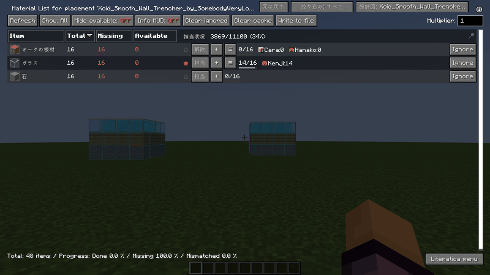

- Litematica MaterialShare は、Litematica のマテリアルリストの各行に「誰が・どの素材を・いくつ集めるか」を表示して、サーバーの全員で同じ内容を見られるようにするアドオンです。
- 使うには、サーバーと全員のクライアントに同じ jar を入れます。クライアントには Litematica、malilib、Syncmatica も必要です。
- 設計図を Syncmatica で共有し、Litematica でその設計図のマテリアルリストを開くと、各行の右側に担当の列が出ます。右上のボタン(「共有を開始」または「設計図: …」)で担当管理を始めます。
- この使い方は、Litematica のメインメニューの「使い方」、マテリアルリストの「ツール」→[表示]→「使い方」、設定のホットキーからいつでも開けます。
- 操作はすべて履歴に残り、画面が小さくてもボタンが重ならないように作られています。

### 設計図を共有する

<b>設計図やその一部を、みんなで管理できるようにする</b>

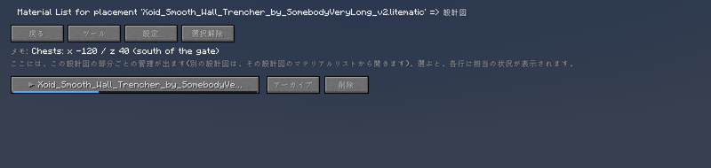

- マテリアルリスト右上のボタンで、設計図の画面が開きます。ここで設計図全体、または複数の部分(サブリージョン)を選んで共有します。
- 部分ごとにチェックを入れて「選んだ部分を共有」、まだの部分は「未共有の部分をすべて共有」で、まとめて作れます。共有した部分は「設計図名 / 部分名」という名前になり、部分ごとに担当を管理できます。
- 共有した設計図は、「アーカイブ」でしまっておくことも、「削除」でゴミ箱に入れることもできます(どちらもあとで戻せます)。
- 同じ名前の設計図が2つあるときは、ツールの「別名で共有」で区別します。メモ(チェストの座標など)も書き込めて、全員に見えます。

### 担当を決める

<b>「担当」ボタンと「＋」ボタン</b>

- 各行の右側に担当の列が出ます。「担当」を押すと、その素材があなたの担当になります(もう一度押すと「解除」)。
- 「＋」を押すと、ほかの人を担当にできます。オフラインの人も、名前の一部を入力して探せます。一覧にいない人は、正確な名前を入力すると探してくれます。
- 担当者が多い行は、入りきらない分が「+数」になります。「≡」を押すと、その素材を担当する全員の一覧が開き、1人ずつ外せます。
- 行の左の★は「先に集めたい」の印で、クリックで付け外しできます。ほかの人があなたを担当にしたり、あなたを外したりすると、画面の隅に知らせが出ます。

### 集めた数を記録する

<b>ホイール、クリック、持ち物の取り込み</b>

- 担当者の名前の上でマウスホイールを回すと、集めた数が増減します(Shift で大きく。設定で、Ctrl を押しているときだけ変わるようにもできます)。
- 名前を左クリックすると、数を入力できます(「3s」と書くと3スタック)。Shift + 左クリックは、いま持っている数の取り込みです。右クリックで、その素材の担当から外れます。
- Ctrl + クリックで、その素材の詳細(分担や納品)の画面が開きます。必要な数に届くと、行が緑になって「Done!」と出ます。
- 設定の「集めた数を自動で更新する」をオンにすると、画面を開いていなくても、持ち物に合わせて集めた数が増えます(減りません)。

### 行を絞り込む

<b>自分の担当、担当なしなど</b>

- マテリアルリストの上にある絞り込みボタンを押すたびに、表示する行が切り替わります: すべて / 自分の担当 / 担当なし / 未完了 / 優先 / 自分以外 / 担当不足 / 特定の人。
- 「特定の人」を選ぶと人を選ぶ画面が開き、その人が担当している行だけが出ます。
- 設定のホットキーでも切り替えられます。

### 分担を決める

<b>人ごとの目標の数を決める</b>

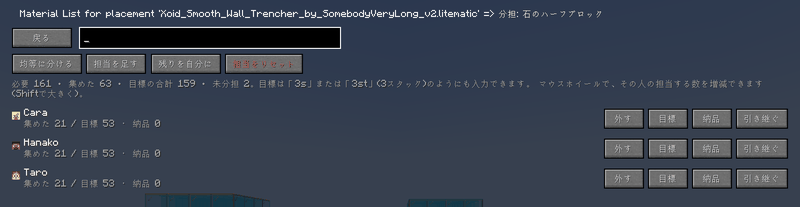

- 素材の詳細画面(Ctrl + クリック、またはツールの「素材の設定」)で、その素材を担当する人ごとに「目標」の数を決められます。
- 「均等に分ける」で担当者に同じ数ずつ割り振れます。「担当を足す」で人を増やし、「残りを自分に」で未分担を自分の目標にします。人ごとの「外す」で担当から外せます。
- マウスホイールで、その人の担当する数を増減できます(Shift で大きく)。目標は「3s」(3スタック)のように入力できます。
- 集めた数のうち倉庫に入れた分は「納品」として別に記録できます。

### 一括で割り当てる

<b>担当のいない素材をまとめて振り分ける</b>

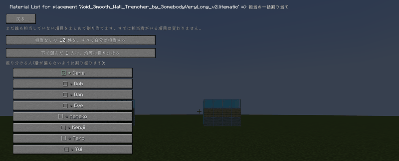

- ツールの「一括割り当て」は、まだ誰も担当していない素材を、選んだ人たちにまとめて振り分けます。量だけでなく種類も考えて、偏らないように割り振ります。すでに担当のいる素材は変わりません。
- 「担当なしの○件を、すべて自分が担当する」で、全部を自分の担当にもできます。やり直しは、ツールの「全員の担当をリセット」、「1人の担当をリセット」でできます(確認が出ます)。
- マテリアルリストの「元に戻す」(ホットキーも可)で、直前の操作を取り消せます。

### ツールの画面

<b>4つのタブにまとまった機能の一覧</b>

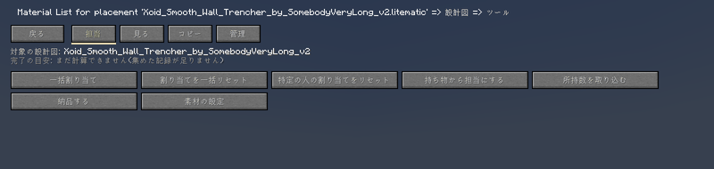
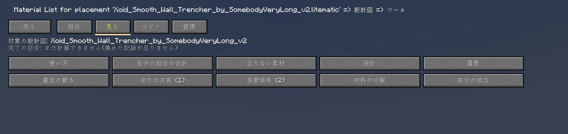

- マテリアルリストの「ツール」には、機能が4つのタブに分かれて入っています。
- 【担当】一括割り当て、担当のリセット、持ち物から担当にする、持ち物の取り込み、納品、素材の設定。
- 【表示】自分の合計、足りない素材、統計、履歴、最近の動き、余り、保管場所、原材料、自分の担当一覧、使い方。
- 【コピー】進み具合を文章でコピー、Discord 用にコピー、足りない素材を「手伝って」の形でコピー。
- 【管理】メモ、設計図から更新、複製、名前の変更、アーカイブ、ゴミ箱、別名で共有、設定。

### 足りない素材

<b>まだ集まっていない素材、担当のいないもの</b>

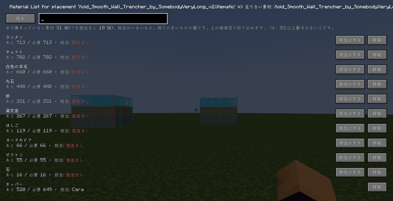

- ツールの「足りない素材」は、まだ集まっていない素材の一覧です。担当のいない素材が先に、次に残りの多い素材が並びます。
- 「担当にする」でそのまま自分の担当にでき、「詳細」でその素材の画面が開きます。担当者の名前に赤い「!」が付いているのは、3日以上なにも操作していない人です。
- 上の検索窓で絞り込めます。

### 自分の合計

<b>自分の担当を素材ごとに合計</b>

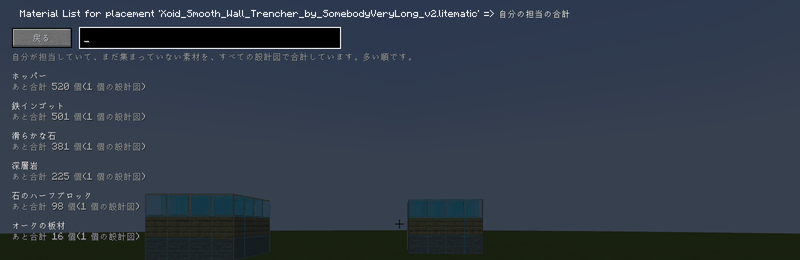

- ツールの「自分の合計」は、あなたが担当してまだ集めていない数を、すべての設計図にわたって素材ごとに足し合わせます。1回の採掘で何を持ち帰ればいいかが、一目でわかります。
- 「自分の担当一覧」では、設計図ごとの担当をそのまま見られます(優先の★のものが先です)。
- 集める素材の残りは、ゲーム画面の右下にも常に出ます(設定でオフにでき、「HUDの位置を設定」でドラッグして好きな場所に置けます。行数も変えられます)。素材ごとに、集めた数/必要数、自分の納品の数、倉庫に入っている数、あと何個かが並びます。

### 保管場所と納品

<b>チェストの範囲を登録し、中身と納品者を記録する</b>

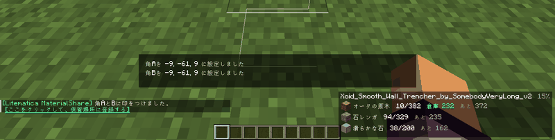
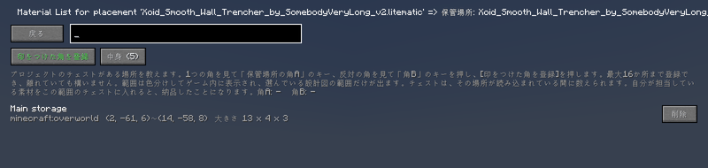
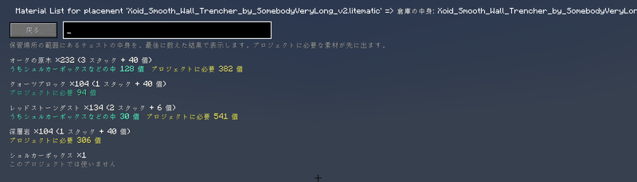
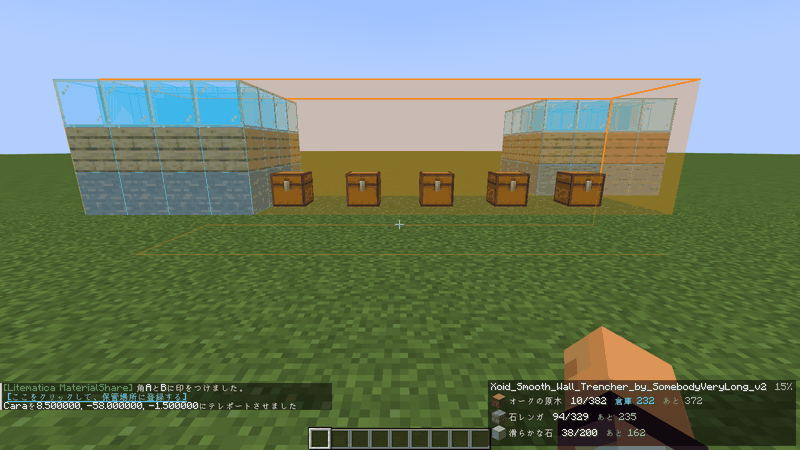

- チェストを置いてある場所を、プロジェクトに教えられます。範囲は最大16か所まで登録でき、離れていても構いません。
1. 範囲の一つの角を見て「保管場所の角A」のキー、反対の角を見て「角B」のキーを押します(キーは設定のホットキーで決めます)。
2. 2つの角に印をつけると、チャットに「[ここをクリックして、保管場所に登録する]」と出ます。クリックすると登録の画面が開くので、[印をつけた角を登録]を押して名前をつけます(ツールの[表示]→「保管場所」からも開けます)。印を間違えてつけたときは、その画面の[印を消す]、設定のホットキー、または /materialshare storage clear で消せます。登録すると印は自動で消えます。
- 登録した範囲は、ゲーム内に色つきの枠で表示されます。選んでいる設計図の範囲だけが出て、設計図を切り替えると表示も切り替わります(設定でオフにできます)。
- すでに素材が入っているチェストを範囲に入れた場合も、その中身が数えられます。シュルカーボックスの中の素材も数えられ、「中身」の画面には「石 ×200 (3スタック + 8個)」のように、スタックでも表示されます。
- 自分が担当している素材を範囲の中のチェストに入れると、チェストを開いているあいだに「納品」として記録され、出すと減ります。シュルカーボックスごと入れた場合も、中身が納品になります。ゲーム画面の隅の残り表示と、マテリアルリストの各行(「倉庫 N」)の数も、すぐに更新されます。ホッパーなど、人の操作でない出し入れは、中身の数にだけ反映されます。
- 対象のブロックは、チェスト、トラップチェスト、樽、シュルカーボックス、ホッパー、ドロッパー、ディスペンサー、醸造台、書見台(置いた本)、ジュークボックス(入れたディスク)です。エンダーチェストは場所ではなく持ち主の収納なので、エンチャントテーブルと大釜はアイテムを持たないので、対象外です。

### 統計と履歴

<b>誰がどれだけ集めたか、誰が何をしたか</b>

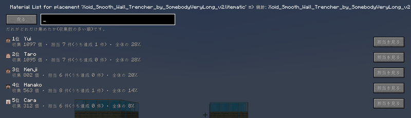
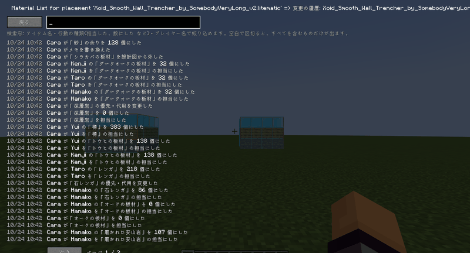

- 「統計」は、誰がどれだけ集めたかを多い順に並べます(3日以上動きのない人には「○日動いていません」と出ます)。
- 「履歴」は、いつ・誰が・何をしたかの記録です。検索窓で、素材名・操作の種類・人の名前から絞り込めます。
- 「最近の動き」は、すべての設計図の最近の変更を新しい順に並べます。
- 素材が揃ったときや設計図が完成したときは、画面の隅に知らせが出ます(チャットにも出す設定があります)。

### 素材の設定

<b>優先、代用のメモ、分担、削除</b>

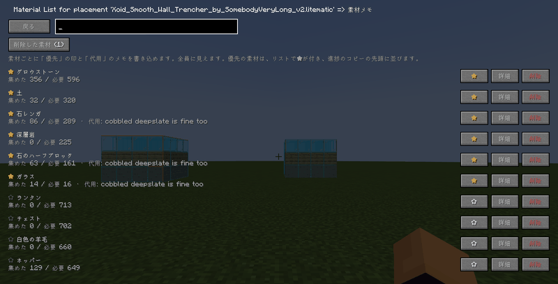

- ツールの「素材の設定」では、素材ごとに「優先」の印(★)と「代用」のメモを書き込めます。全員に見えます。優先の素材は一覧で★が付き、進み具合のコピーの先頭に並びます。
- 「詳細」から分担と納品の画面を開けます。素材は削除することもでき、削除した素材は担当や数ごと「削除した素材」から戻せます。
- 設計図を作り直したときは、ツールの「設計図から更新」で、新しい素材を加え、必要な数を合わせます(いらなくなった素材は残ります)。

### 余りを共有する

<b>持て余している素材を、みんなに知らせる</b>

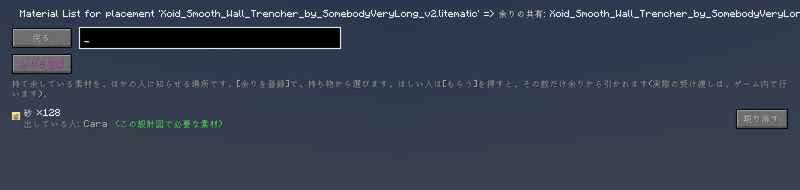

- ツールの「余り」は、持て余している素材をほかの人に知らせる場所です。[余りを登録]で持ち物から選び、出す数を入力します(0で取り消し)。
- ほしい人は[もらう]を押すと、その数だけ余りから引かれます。実際の受け渡しは、ゲーム内で行います。その設計図で必要な素材には印が付きます。

### 原材料の分解図

<b>素材を作るのに必要な材料をたどる</b>

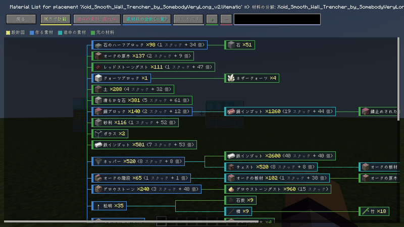

- ツールの「原材料」は、クラフトのレシピをたどって、必要な素材を作るための元の材料の数を計算します。色分けしたマップで、設計図 → 作る素材 → 途中の素材 → 元の材料 の流れを見られます。
- 「残りで計算」と「全体で計算」を切り替えられ、「原材料の合計(一覧)」で元の材料だけの一覧も見られます。かまどで焼くものや拾うものは、そこで止まります。ホットキーで直接開くこともできます。

### 整理と復元

<b>アーカイブ、ゴミ箱、複製、名前の変更</b>

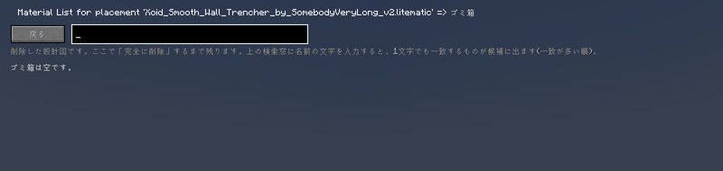
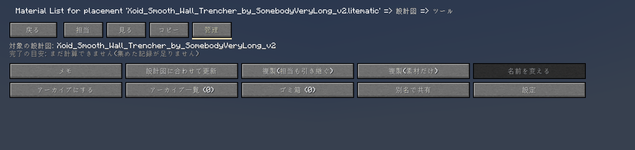

- 終わった設計図は「アーカイブへ移動」でしまっておけます(データは残り、いつでも戻せます)。削除した設計図は「ゴミ箱」に入り、そこから復元するか、完全に削除できます。
- 「複製」は、同じ素材の新しい設計図を作ります(人を残す / 素材だけ、の2通り)。「名前の変更」は、「設計図名 / ○○」の○○を変えます。
- どれも、誰が操作したかが履歴に残ります。

### 設定とホットキー

<b>表示や通知を好みに合わせる</b>

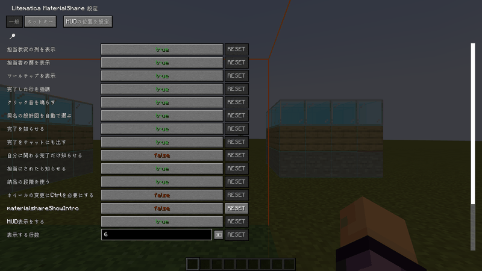
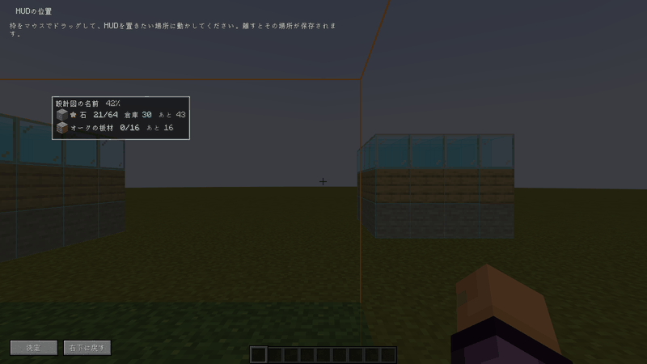

- 設定は、Litematica のメインメニューの「MaterialShare 設定」、設計図の画面の[設定]、Mod Menu から開けます。
- 担当の列や顔の表示、ツールチップ、完了や割り当ての通知、ホイールの増減量、納品の段階を使うか、HUD(残り表示)とその位置、保管場所の表示などを変えられます。
- 「ホットキー」のタブでは、設定画面、設計図画面、原材料、担当列の切り替え、残り表示の切り替え、持っているアイテムを担当にする、元に戻す、絞り込みの切り替え、保管場所の角A・B、角の印を消す、使い方、のキーを決められます。

### チャットコマンド

<b>/materialshare で手早く確認</b>

- `/materialshare help` — コマンドの一覧
- `/materialshare progress` — 選んでいる設計図の進み具合
- `/materialshare mine` — 自分の未完了の担当
- `/materialshare surplus` — 出されている余り
- `/materialshare storage` — 保管場所の画面を開く
- `/materialshare storage clear` — 角の印を消す
- `/materialshare projects` — 共有している設計図と進み具合
- `/materialshare select <名前>` — 設計図を選ぶ
- コマンドは手早く見るためのものです。ほかの操作は、マテリアルリストの画面で行います。

### サーバーの管理者へ

<b>導入、設定ファイル、データの保存先</b>

- サーバーには、このMODと Fabric API、malilib、Syncmatica を入れます(Litematica は不要です)。全員のクライアントに同じverの jar が必要で、verが合わないと参加時に理由が表示されます。
- 初回の起動で config/litematica_materialshare_server.json が作られます。「maxProjects」で、同時に共有できる設計図の数(1〜64)を決められます。
- データはサーバーのワールドに保存されます。MODを入れた全員が全プロジェクトを見られ、誰でも編集できます(操作は履歴に残ります)。保管場所のチェストの中身は、サーバーが読み込んでいる場所だけ数えられます。

### 設定・ホットキーの一覧

<b>設定・ホットキーの一覧</b>

| 名前 | 内容 |
|---|---|
| 担当状況の列を表示 | マテリアルリストの各行の右側に、担当状況の列を表示します。 |
| 担当者の顔を表示 | 担当者の名前の横に、スキンの顔を表示します。 |
| ツールチップを表示 | ボタンや担当者にカーソルを乗せたとき、操作の説明を表示します。 |
| 完了した行を強調 | 必要数を集め終えた行を、薄い緑で強調します。 |
| クリック音を鳴らす | 担当ボタンなどを押したとき、クリック音を鳴らします。 |
| 同名の設計図を自動で選ぶ | マテリアルリストを開いたとき、設計図と同じ名前の設計図を自動で選びます。 |
| 完了を知らせる | 素材が揃ったとき、設計図が完成したときに、画面の隅に知らせを出します。 |
| 集めた数を自動で更新する | 画面を開いていなくても、持ち物に合わせて、自分が担当している素材の集めた数を増やします(減らしません)。 |
| ホイールの増減量 | 担当者の上でホイールを回したときに増減する数です。 |
| Shift + ホイールの増減量 | Shift を押しながらホイールを回したときに増減する数です(64 = 1スタック)。 |
| 設定画面を開く | この設定画面を開きます。 |
| 設計図画面を開く | マテリアルリスト画面を開いているとき、設計図画面を開きます。 |
| 担当状況の列の表示を切り替える | 「担当状況の列を表示」を切り替えます。 |
| 操作を元に戻す | マテリアルリスト画面を開いているとき、直前の操作を元に戻します。 |
| 表示する行を切り替える | マテリアルリスト画面を開いているとき、表示する行(すべて / 自分の担当 / 担当なし / 未完了 / 優先 / 自分以外 / 担当不足)を切り替えます。 |
| 担当を外すときに確認する | 担当者を項目から外す前に、確認のダイアログを出します。 |
| 完了をチャットにも出す | 完了のお知らせを、画面の隅だけでなくチャット欄にも表示します。 |
| 自分に関わる完了だけ知らせる | オンにすると、自分が担当している素材の完了と、自分が担当を持つ設計図の完成だけ知らせます。 |
| 個数をスタックでも表示 | ツールチップに、必要数を「10 スタック + 60 個」のようにも表示します。 |
| 担当にされたら知らせる | ほかの人があなたを素材の担当にしたとき、知らせます。 |
| 納品の段階を使う | 集めた数とは別に「倉庫に納めた数」を記録します。共有の倉庫を使わないチームはオフにできます。 |
| ホイールの変更にCtrlを必要にする | オンにすると、Ctrlを押しながらのときだけ、マウスホイールで数が変わります(リストのスクロールで間違えて変えないため)。 |
| HUD表示をする | ゲーム画面に、自分が集める素材の残りの枠(HUD)を表示します。場所は、設定の上の「HUDの位置を設定」で決めます。 |
| 表示する行数 | 画面に出す残りの素材の、最大の行数です。 |
| 材料の分解を開く | 選んでいる設計図の、元の材料の一覧(レシピから計算)を直接開きます。 |
| 残りの素材の表示を切り替える | ゲーム画面の、残りの素材の表示を出したり消したりします。 |
| 持っているアイテムを担当にする | 選んでいる設計図で、手に持っているアイテムを自分の担当にします(持っている数も取り込みます)。 |
| 保管場所を世界に表示 | 選んでいる設計図の保管場所の範囲を、ゲーム内に色つきの枠で表示します。 |
| 保管場所の角Aに印をつける | 見ているブロックを、保管場所の1つ目の角にします。 |
| 保管場所の角Bに印をつける | 見ているブロックを、保管場所の反対側の角にします。 |
| 使い方を開く | 使い方の画面を、いつでも開きます。 |
| 保管場所の角の印を消す | 角AとBの印を消します(間違えて印をつけたときに使います)。 |

<!-- FEATURES-JA:END -->

## 導入

| 場所 | 必要なもの |
|---|---|
| サーバー | Fabric Loader 0.14.21 以上、Fabric API 0.76.0 以上、**malilib**、**Syncmatica**、**本MOD**(Litematica は不要) |
| クライアント | 上に加えて、**Litematica**(verは下の表を見てください) |

**対応するver**(Minecraft のverごとに jar が別です。遊んでいるverに合う jar を使ってください):

| Minecraft | Litematica | malilib | jar |
|---|---|---|---|
| 1.18 | 0.9.x(確認: 0.9.1) | 0.10.x(確認: 0.10.0-dev.26) | `...-0.10.0+1.18.jar` |
| 1.18.1 | 0.10.x(確認: 0.10.4) | 0.11.x(確認: 0.11.8) | `...-0.10.0+1.18.1.jar` |
| 1.18.2 | 0.11.x(確認: 0.11.7) | 0.12.x(確認: 0.12.1) | `...-0.10.0+1.18.2.jar` |
| 1.19 | 0.12.x(確認: 0.12.2) | 0.13.x(確認: 0.13.0) | `...-0.10.0+1.19.jar` |
| 1.19.1 | 0.12.x(確認: 0.12.3) | 0.13.x(確認: 0.13.0) | `...-0.10.0+1.19.1.jar` |
| 1.19.2 | 0.12.x(確認: 0.12.7) | 0.13.x(確認: 0.13.0) | `...-0.10.0+1.19.2.jar` |
| 1.19.3 | 0.13.x(確認: 0.13.2) | 0.14.x(確認: 0.14.0) | `...-0.10.0+1.19.3.jar` |
| 1.19.4 | 0.14.2 以上 0.15.0 未満(確認: 0.14.7) | 0.15.2 以上 0.16.0 未満(確認: 0.15.4) | `...-0.10.0.jar` |
| 1.20.1 | 0.15.x(確認: 0.15.4) | 0.16.x(確認: 0.16.3) | `...-0.10.0+1.20.1.jar` |
| 1.20.2 | 0.16.x(確認: 0.16.1) | 0.17.x(確認: 0.17.0) | `...-0.10.0+1.20.2.jar` |
| 1.20.3 | 0.17.x(確認: 0.17.4) | 0.18.x(確認: 0.18.3) | `...-0.10.0+1.20.3.jar` |
| 1.20.4 | 0.17.x(確認: 0.17.4) | 0.18.x(確認: 0.18.3) | `...-0.10.0+1.20.4.jar` |
| 1.20.5 | 0.18.x(確認: 0.18.3) | 0.19.x(確認: 0.19.2) | `...-0.10.0+1.20.5.jar` |
| 1.20.6 | 0.18.x(確認: 0.18.3) | 0.19.x(確認: 0.19.2) | `...-0.10.0+1.20.6.jar` |

Syncmatica はどのverでも可。Fabric API は 0.76.0 以上(1.19 と 1.19.1 は 0.58.0 以上、1.18 と 1.18.1 は 0.44.0 以上)。

1.20.x の Fabric API: 1.20.1 は 0.92.2 以上、1.20.2 は 0.91.6 以上、1.20.3 は 0.91.1 以上、1.20.4 は 0.97.2 以上、1.20.5 は 0.97.8 以上、1.20.6 は 0.100.8 以上。Minecraft 1.20.5 と 1.20.6 は Java 21 が必要です。Minecraft 1.20 そのものの jar はありません(Litematica に 1.20 用の build が無いため。1.20.1 を使ってください)。

- サーバーとクライアントの**両方**に、同じ jar を入れます。
- 担当管理を始めるには、設計図が **Syncmatica で共有**されている必要があります。共有されていれば、マテリアルリストを開くと自動で担当管理が始まります。
- 任意: Mod Menu(設定画面を開けます)。
- 設定画面は、Litematica のメインメニューからも開けます。

## 使い方

1. Syncmatica で設計図を共有して、Litematica でマテリアルリストを開きます。
2. 右上のボタン(「共有を開始」または「設計図: …」)で担当管理を始めます。
3. 各行の右側で、担当を決めます。画面上部の「ツール」から、一括割り当て・統計・履歴などを使います。

## サーバー管理者向け

初回の起動で `config/litematica_materialshare_server.json` が作られます。

| 項目 | 内容 |
|---|---|
| `maxProjects` | 同時に共有できる設計図の数(1〜64)。初期値は 64 |

データはサーバーのワールドに保存されます。MODを入れた全員が全プロジェクトを見られ、誰でも編集できます(操作は履歴に残ります)。

## ver ごとの違い

機能は、すべてのverで同じソースから作っています。verごとに違うのは、前提MODのverと Java です(上の「導入」の表を見てください)。

- Minecraft 1.20.5 と 1.20.6 は **Java 21** が必要です(それ以前は Java 17)。
- Minecraft 1.20 そのものの jar はありません(1.20.1 を使ってください)。
- 1.19.4 の jar だけ、名前に ver が付きません(`...-0.10.0.jar`)。
- 機能がverによって違うことが分かったときは、その機能の説明の中に「ver ごとの注意」を書きます。

## 互換性

Litematica / malilib の画面には mixin の `@Inject` だけで追加しており、他の mod の処理を上書きしません。Sodium、Sodium Extra、Reese's Sodium Options と一緒に動くことを確認しています。画面の大きさ(GUI 設定)を変えても、ボタンが重ならないように作っています。

---

# Litematica MaterialShare

**English** | [日本語](#litematica-materialshare)

> [!TIP]
> Many features: press **Ctrl + F** to search for the one you want (for example "storage"), or use the "↓" links in the "Features" table below.

**An add-on for Litematica that shows who collects which material, and how much, to everybody on the server.**
(Fabric / Minecraft 1.18, 1.18.1, 1.18.2, 1.19, 1.19.1, 1.19.2, 1.19.3, 1.19.4, 1.20.1, 1.20.2, 1.20.3, 1.20.4, 1.20.5, 1.20.6)

Building together, you keep asking "who takes the redstone?" and "how many oak logs are still missing?" in chat.
This add-on puts **who takes an item and how much they have collected** right into each row of Litematica's material list, the same for every player.

<!-- FEATURES-EN:START -->
## Features

| Feature | In short | Details |
|---|---|---|
| Getting started | What this add-on does and what you need | [↓](#f-en-start) |
| Sharing a schematic | Making a schematic, or parts of it, trackable by everybody | [↓](#f-en-share) |
| Taking items | The Take button and the + button | [↓](#f-en-claim) |
| Recording amounts | The wheel, clicks, and importing what you carry | [↓](#f-en-amounts) |
| Filtering rows | Mine, nobody, unfinished and more | [↓](#f-en-filter) |
| Splitting an item | Giving each person a target amount | [↓](#f-en-split) |
| Bulk assignment | Handing out everything nobody takes yet | [↓](#f-en-bulk) |
| The tools screen | Everything else, sorted into four tabs | [↓](#f-en-tools) |
| Missing items | What is not collected yet, and what nobody takes | [↓](#f-en-missing) |
| My totals | Everything you still have to collect, added up | [↓](#f-en-totals) |
| Storage boxes | Registering chest areas; contents and who handed in | [↓](#f-en-storage) |
| Stats and history | Who collected how much, and who did what | [↓](#f-en-stats) |
| Item settings | Priority, substitute notes, split and removal | [↓](#f-en-items) |
| Spare items | Telling the others about items you have too many of | [↓](#f-en-surplus) |
| Raw materials | Following the recipes down to the raw materials | [↓](#f-en-breakdown) |
| Archive, trash and copies | Tucking away, restoring, duplicating, renaming | [↓](#f-en-manage) |
| Settings and hotkeys | Making the display and the notices fit you | [↓](#f-en-settings) |
| Chat commands | A quick look from the chat | [↓](#f-en-commands) |
| For server owners | Installing, the config file, where the data lives | [↓](#f-en-server) |

## Feature details

Press an entry to open its explanation and pictures.

### Getting started

<b>What this add-on does and what you need</b>

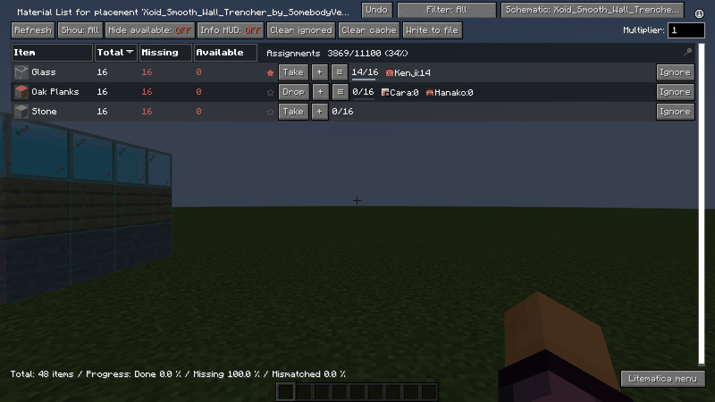

- Litematica MaterialShare shows, in every row of Litematica's material list, who takes which material and how much they have collected, the same for everybody on the server.
- Put the same jar on the server and on every client. Clients also need Litematica, malilib and Syncmatica.
- Share the schematic with Syncmatica and open its material list in Litematica: a column with the assignments appears at the right of every row. The button at the top right ("Start sharing" or "Schematic: ...") starts the tracking.
- You can open this guide at any time from Litematica's main menu ("How to use"), from the material list under Tools > View > "How to use", or with a hotkey from the settings.
- Every action is kept in the history, and the buttons never overlap, even on a small screen.

### Sharing a schematic

<b>Making a schematic, or parts of it, trackable by everybody</b>

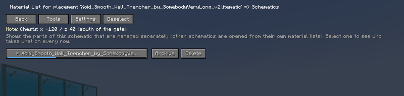

- The button at the top right of the material list opens the schematic screen. There you share the whole schematic, or some of its parts (sub-regions).
- Tick the parts and press "Share chosen parts", or press "Share all parts not shared yet". A shared part is named "schematic name / part name" and has its own assignments.
- A shared schematic can be tucked away with "Archive" or put in the trash with "Delete" (both can be undone later).
- When two schematics have the same name, tell them apart with "Share as..." in the tools. You can also write a note (chest coordinates and so on) that everybody sees.

### Taking items

<b>The Take button and the + button</b>

- A column with the assignments appears at the right of every row. "Take" makes the item yours (press again to "Drop" it).
- "+" assigns somebody else. Offline players can be found by part of their name; if somebody is not listed, type the exact name and it is looked up.
- When a row has more people than fit, the rest shows as "+number". "≡" opens everybody who takes the item, and you can remove people one by one.
- The ★ at the left of a row means "collect this first"; click it to set or clear it. When somebody assigns you to an item or takes you off one, a notice appears in the corner of the screen.

### Recording amounts

<b>The wheel, clicks, and importing what you carry</b>

- Turn the mouse wheel over a name to change the collected amount (Shift for bigger steps; a setting can require Ctrl so that scrolling never changes a number by accident).
- Left click a name to type a number ("3s" means 3 stacks). Shift + left click imports what you carry. Right click takes you off the item.
- Ctrl + click opens the details of the item (split and hand-in). When the needed amount is reached the row turns green and says "Done!".
- With "Update my collected counts automatically" turned on in the settings, your counts follow what you carry even while no screen is open (they never go down).

### Filtering rows

<b>Mine, nobody, unfinished and more</b>

- Every press of the filter button above the material list changes the rows shown: All / Mine / Unclaimed / Incomplete / Priority / Others' / Needs people / One person.
- "One person" opens a picker, and then only the rows that person takes are shown.
- A hotkey in the settings does the same.

### Splitting an item

<b>Giving each person a target amount</b>

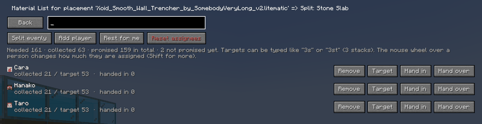

- In the item details (Ctrl + click, or "Item settings" in the tools) you can give each person who takes the item a target amount.
- "Split evenly" shares it equally among the people. "Add player" adds somebody, and "Rest for me" makes the unassigned amount your target. "Remove" takes one person off.
- The mouse wheel changes the amount of the person under it (Shift for bigger steps). Targets can be typed like "3s" (3 stacks).
- How much of what was collected has gone into the storage can be recorded separately as "handed in".

### Bulk assignment

<b>Handing out everything nobody takes yet</b>

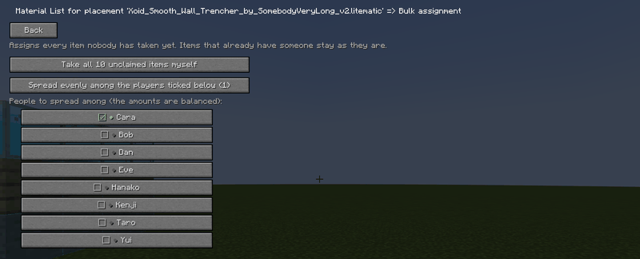

- "Bulk assign" in the tools hands out every item nobody takes yet to the people you pick, balanced by amount and by kind. Items that already have somebody stay as they are.
- You can also take all of them yourself. To start over, use "Reset all assignments" or "Reset one person's assignments" in the tools (they ask first).
- Undo in the material list (also available as a hotkey) takes back your last action.

### The tools screen

<b>Everything else, sorted into four tabs</b>

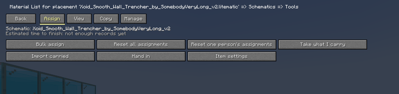
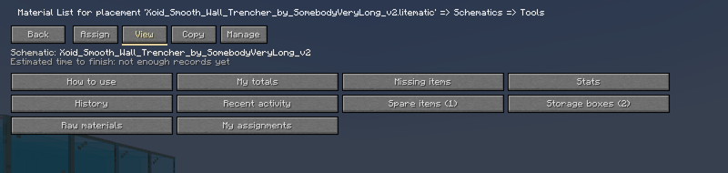

- "Tools" in the material list holds the features in four tabs.
- [Assign] bulk assign, resets, take what I carry, import carried, hand in, item settings.
- [View] my totals, missing items, stats, history, recent activity, spare items, storage boxes, raw materials, my assignments, how to use.
- [Copy] copy the progress as text, copy for Discord, copy the unassigned items as a call for help.
- [Manage] note, update from schematic, duplicate, rename, archive, trash, share as..., settings.

### Missing items

<b>What is not collected yet, and what nobody takes</b>

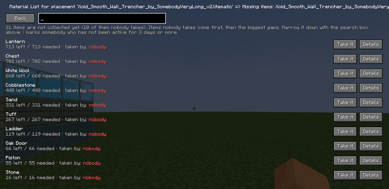

- "Missing items" in the tools lists what is not collected yet: the items nobody takes come first, then the biggest gaps.
- "Take it" makes an item yours right there, and "Details" opens its screen. A red "!" after a name marks somebody who has not done anything for 3 days or more.
- Narrow the list down with the search box above.

### My totals

<b>Everything you still have to collect, added up</b>

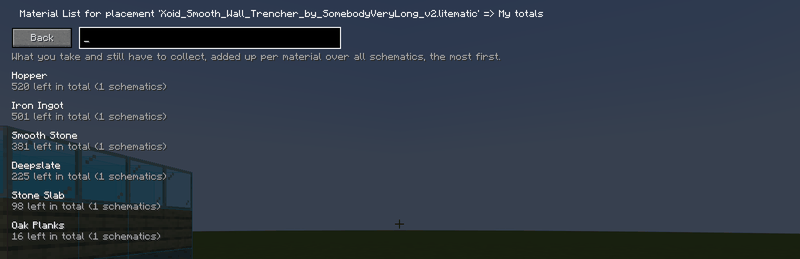

- "My totals" in the tools adds up what you still have to collect over all schematics, per material, so you know what to bring back from one trip to the mine.
- "My assignments" shows your assignments schematic by schematic (priority ★ items first).
- What you still have to collect is also shown at the bottom right of the game screen (it can be turned off, dragged to any place with "Set the HUD place" in the settings, and shortened). Each material shows collected/needed, what you handed in, what lies in the storage, and how many are left.

### Storage boxes

<b>Registering chest areas; contents and who handed in</b>

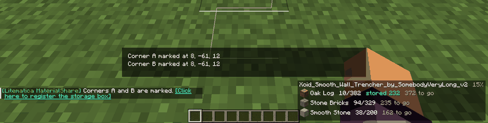
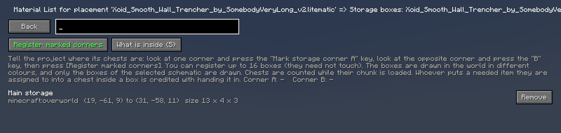
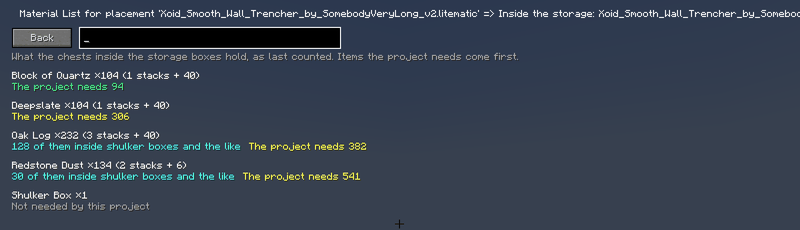
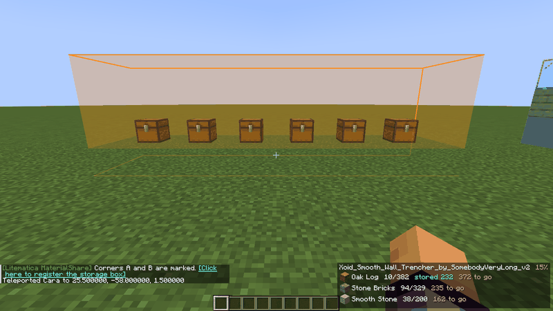

- You can tell the project where its chests are. Up to 16 areas can be registered, and they need not touch.
1. Look at one corner of the area and press the "Mark storage corner A" key, then look at the opposite corner and press the "B" key (set the keys under Hotkeys in the settings).
2. Once both corners are marked, a chat line "[Click here to register the storage box]" appears. Click it to open the registration screen, press [Register marked corners] and give the area a name (the same screen is under Tools > [View] > "Storage boxes"). If you marked a corner by mistake, clear the marks with [Clear marks] on that screen, with the hotkey, or with /materialshare storage clear; registering clears them automatically.
- The registered areas are drawn in the world as coloured boxes. Only the areas of the selected schematic are drawn, and they switch when you select another schematic (this can be turned off in the settings).
- Chests that already hold materials when they are put into an area are counted too. What lies inside shulker boxes is counted as well, and [What is inside] also writes the amount as stacks, for example "Stone ×200 (3 stacks + 8)".
- When you put an item you are assigned to into a chest inside an area, it is recorded as "handed in" while the chest is open, and taking it out lowers it again. A shulker box put in counts by its contents. The list in the corner of the screen and the "stored N" in each row of the material list follow at once. Moves that no player makes, such as hoppers, only change the contents count.
- The blocks that count are chests, trapped chests, barrels, shulker boxes, hoppers, droppers, dispensers, brewing stands, lecterns (the book on them) and jukeboxes (the disc inside). Ender chests are not counted because they hold a player's items, not a place's, and enchanting tables and cauldrons hold no items.

### Stats and history

<b>Who collected how much, and who did what</b>

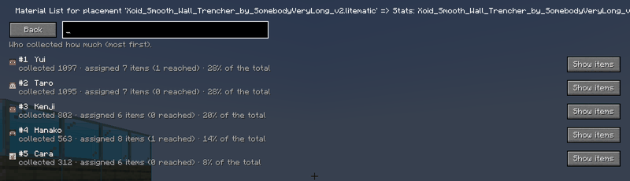
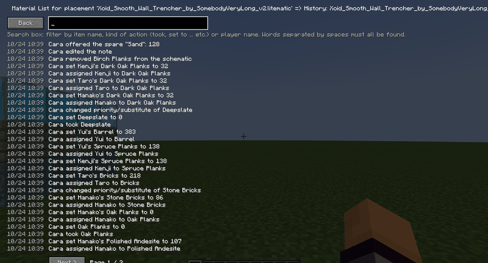

- "Stats" lists who collected how much, most first (somebody who has been away for 3 days or more is marked "not active for N days").
- "History" is the record of who did what and when. The search box narrows it down by item name, kind of action or player.
- "Recent activity" shows the latest changes of every schematic, newest first.
- A notice appears in the corner when materials or a whole schematic are complete (a setting also writes it into the chat).

### Item settings

<b>Priority, substitute notes, split and removal</b>

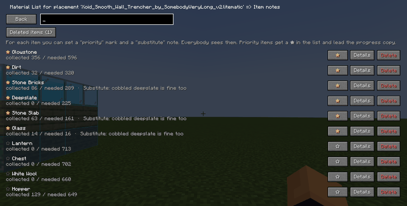

- "Item settings" in the tools sets a priority mark (★) and a substitute note per item. Everybody sees them. Priority items get a ★ in the list and lead the progress copy.
- "Details" opens the split and hand-in screens. Items can be deleted, and deleted items come back with their assignments and counts from "Deleted items".
- When the schematic changed, "Update from schematic" in the tools adds new items and adjusts the required amounts (items no longer needed are kept).

### Spare items

<b>Telling the others about items you have too many of</b>

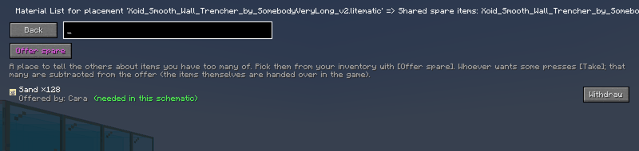

- "Spare items" in the tools is a place to tell the others about items you have too many of. Pick them from your inventory with [Offer spare] and enter how many you give away (0 takes the offer back).
- Whoever wants some presses [Take], and that many are subtracted from the offer. The items themselves are handed over in the game. Items the schematic needs are marked.

### Raw materials

<b>Following the recipes down to the raw materials</b>

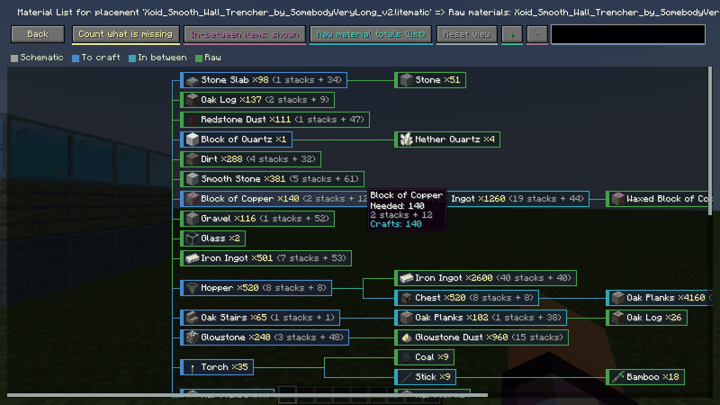

- "Raw materials" in the tools follows the crafting recipes and works out the raw materials needed. A colour-coded map shows schematic > crafted items > intermediate items > raw materials.
- Switch between "remaining" and "everything", or open the plain list of raw materials. Things that are smelted or found stop the chain. A hotkey opens it directly.

### Archive, trash and copies

<b>Tucking away, restoring, duplicating, renaming</b>

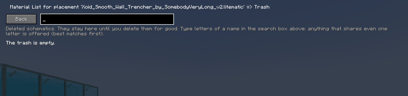
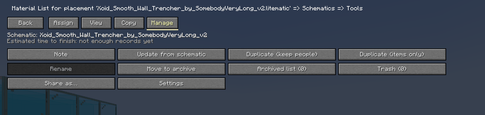

- A finished schematic can be tucked away with "Move to archive" (nothing is lost, and it can be brought back). A deleted schematic goes to the "Trash", where you can restore it or delete it for good.
- "Duplicate" makes a new schematic with the same items (keeping the people, or items only). "Rename" changes the ◯◯ of "schematic name / ◯◯".
- Each of these is recorded in the history.

### Settings and hotkeys

<b>Making the display and the notices fit you</b>

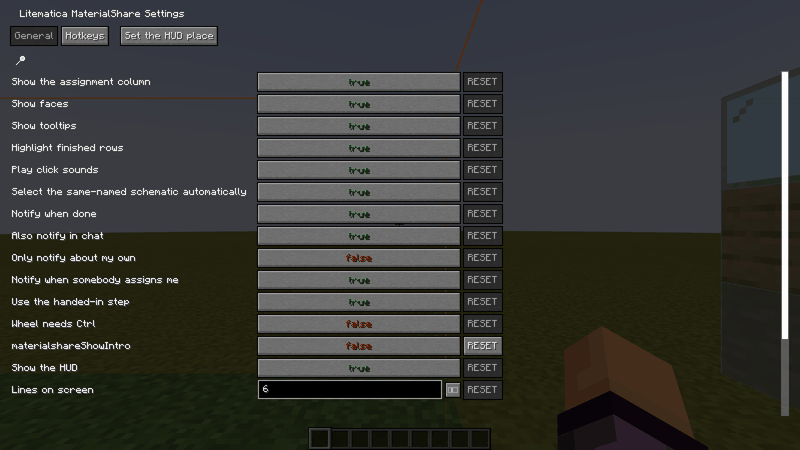
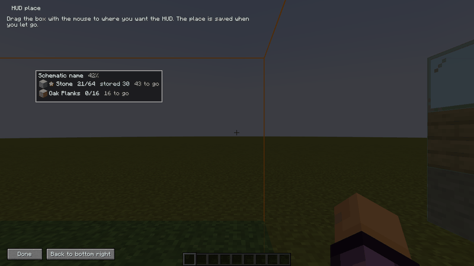

- The settings open from "MaterialShare settings" in Litematica's main menu, from [Settings] on the schematic screen, and from Mod Menu.
- You can change the assignment column and faces, tooltips, completion and assignment notices, the wheel steps, whether the hand-in step is used, the HUD (remaining items) and its place, the storage boxes in the world and more.
- The "Hotkeys" tab sets keys for the settings screen, the schematic screen, raw materials, toggling the column, toggling the corner list, taking the item you hold, undo, cycling the filter, storage corners A and B, clearing the corner marks, and this guide.

### Chat commands

<b>A quick look from the chat</b>

- `/materialshare help` — the list of commands
- `/materialshare progress` — how far the selected schematic is
- `/materialshare mine` — your unfinished assignments
- `/materialshare surplus` — the spare items offered
- `/materialshare storage` — opens the storage boxes screen
- `/materialshare storage clear` — clears the corner marks
- `/materialshare projects` — the shared schematics and how far they are
- `/materialshare select <name>` — picks a schematic
- The commands are for a quick look. Everything else is done in the material list screen.

### For server owners

<b>Installing, the config file, where the data lives</b>

- The server needs this mod, Fabric API, malilib and Syncmatica (Litematica is not needed). Every client needs the same version of the jar; when the versions differ, the reason is shown when joining.
- config/litematica_materialshare_server.json is created on the first start. "maxProjects" sets how many schematics can be shared at once (1-64).
- The data is stored in the world. Everybody with the mod sees all projects and can edit them (every action is in the history). The contents of storage chests are counted only where the server has the chunks loaded.

### All settings and hotkeys

<b>All settings and hotkeys</b>

| Name | What it does |
|---|---|
| Show the assignment column | Shows the assignment column to the right of every material list row. |
| Show faces | Shows the skin face next to each assignee's name. |
| Show tooltips | Shows an explanation when the cursor is over a button or an assignee. |
| Highlight finished rows | Highlights rows whose required amount is collected in light green. |
| Play click sounds | Plays a click sound when you press the assignment buttons. |
| Select the same-named schematic automatically | Selects the schematic named like the schematic when you open its material list. |
| Notify when done | Shows a notice in the corner of the screen when materials or the whole schematic are complete. |
| Update my collected counts automatically | Raises your collected counts to what you carry, even while no screen is open (never lowers them). |
| Wheel step | Amount changed per wheel step over an assignee. |
| Wheel step with Shift | Amount changed per wheel step with Shift held (64 = one stack). |
| Open the settings screen | Opens this settings screen. |
| Open the schematic screen | Opens the schematic screen while the material list is open. |
| Toggle the assignment column | Toggles "Show the assignment column". |
| Undo last action | Undoes your last action while the material list is open. |
| Cycle the row filter | Cycles the shown rows (All / Mine / Unclaimed / Incomplete) while the material list is open. |
| Confirm before removing an assignee | Shows a confirmation dialog before taking someone off an item. |
| Also notify in chat | Writes the completion notices into the chat as well as in the corner of the screen. |
| Only notify about my own | When on, only tells about materials you are assigned to and schematics you take part in. |
| Show counts as stacks too | Also shows the needed amount as "10 stacks + 60" in the tooltips. |
| Notify when somebody assigns me | Tells you when somebody else makes you a claimant of an item. |
| Use the handed-in step | Records how much went into the shared storage, apart from what was collected. Teams without a storage can turn it off. |
| Wheel needs Ctrl | When on, the mouse wheel changes a count only while Ctrl is held (so scrolling the list never changes one by accident). |
| Show the HUD | Shows a box with the items you still have to collect on the game screen. Its place is set with "Set the HUD place" at the top of the settings. |
| Lines on screen | How many items the on-screen list shows at most. |
| Open the raw materials | Opens the raw materials of the selected schematic (worked out from the recipes). |
| Toggle the on-screen list | Shows or hides the list of remaining items on the game screen. |
| Take the item I am holding | Makes the item in your main hand yours in the selected schematic (and imports how many you carry). |
| Show the storage boxes in the world | Draws the storage boxes of the selected schematic in the world, each in its own colour. |
| Mark storage corner A | Marks the first corner of a storage box at the block you look at. |
| Mark storage corner B | Marks the opposite corner of a storage box at the block you look at. |
| Open the how-to | Opens the how-to screen at any time. |
| Clear the storage corner marks | Takes away the marks of corners A and B (for a corner marked by mistake). |

<!-- FEATURES-EN:END -->

## Installation

| Where | What you need |
|---|---|
| Server | Fabric Loader 0.14.21+, Fabric API 0.76.0+, **malilib**, **Syncmatica**, **this mod** (Litematica is not needed) |
| Client | The same, plus **Litematica** (versions: see the table below) |

**Supported versions** (one jar per Minecraft version; use the jar that matches your game):

| Minecraft | Litematica | malilib | Jar |
|---|---|---|---|
| 1.18 | 0.9.x (tested: 0.9.1) | 0.10.x (tested: 0.10.0-dev.26) | `...-0.10.0+1.18.jar` |
| 1.18.1 | 0.10.x (tested: 0.10.4) | 0.11.x (tested: 0.11.8) | `...-0.10.0+1.18.1.jar` |
| 1.18.2 | 0.11.x (tested: 0.11.7) | 0.12.x (tested: 0.12.1) | `...-0.10.0+1.18.2.jar` |
| 1.19 | 0.12.x (tested: 0.12.2) | 0.13.x (tested: 0.13.0) | `...-0.10.0+1.19.jar` |
| 1.19.1 | 0.12.x (tested: 0.12.3) | 0.13.x (tested: 0.13.0) | `...-0.10.0+1.19.1.jar` |
| 1.19.2 | 0.12.x (tested: 0.12.7) | 0.13.x (tested: 0.13.0) | `...-0.10.0+1.19.2.jar` |
| 1.19.3 | 0.13.x (tested: 0.13.2) | 0.14.x (tested: 0.14.0) | `...-0.10.0+1.19.3.jar` |
| 1.19.4 | 0.14.2 or newer, older than 0.15.0 (tested: 0.14.7) | 0.15.2 or newer, older than 0.16.0 (tested: 0.15.4) | `...-0.10.0.jar` |
| 1.20.1 | 0.15.x (tested: 0.15.4) | 0.16.x (tested: 0.16.3) | `...-0.10.0+1.20.1.jar` |
| 1.20.2 | 0.16.x (tested: 0.16.1) | 0.17.x (tested: 0.17.0) | `...-0.10.0+1.20.2.jar` |
| 1.20.3 | 0.17.x (tested: 0.17.4) | 0.18.x (tested: 0.18.3) | `...-0.10.0+1.20.3.jar` |
| 1.20.4 | 0.17.x (tested: 0.17.4) | 0.18.x (tested: 0.18.3) | `...-0.10.0+1.20.4.jar` |
| 1.20.5 | 0.18.x (tested: 0.18.3) | 0.19.x (tested: 0.19.2) | `...-0.10.0+1.20.5.jar` |
| 1.20.6 | 0.18.x (tested: 0.18.3) | 0.19.x (tested: 0.19.2) | `...-0.10.0+1.20.6.jar` |

Syncmatica: any version. Fabric API: 0.76.0 or newer (1.19 and 1.19.1: 0.58.0 or newer; 1.18 and 1.18.1: 0.44.0 or newer).

Fabric API for 1.20.x: 1.20.1 0.92.2 or newer, 1.20.2 0.91.6, 1.20.3 0.91.1, 1.20.4 0.97.2, 1.20.5 0.97.8, 1.20.6 0.100.8 (each or newer). Minecraft 1.20.5 and 1.20.6 need Java 21. There is no jar for Minecraft 1.20 itself, because Litematica has no build for it (use 1.20.1).

- Put the same jar on the server **and** on every client.
- A schematic must be **shared with Syncmatica** to be tracked; open its material list and tracking starts by itself.
- Optional: Mod Menu (opens the settings).
- The settings screen is also in Litematica's main menu.

## How to use

1. Share the schematic with Syncmatica and open its material list in Litematica.
2. Start tracking with the button at the top right ("Start sharing" or "Schematic: ...").
3. Decide who takes what in the right-hand column of each row. "Tools" at the top has bulk assigning, stats, history and more.

## For server owners

`config/litematica_materialshare_server.json` is created on the first start.

| Key | Meaning |
|---|---|
| `maxProjects` | How many schematics can be shared at once (1-64). Default 64 |

Data is stored in the world. Everybody with the mod sees all schematics and can edit them (every action is in the history).

## Differences between versions

All versions are built from the same source, so the features are the same. What differs per Minecraft version are the prerequisite mods and Java (see the table under "Installation").

- Minecraft 1.20.5 and 1.20.6 need **Java 21** (Java 17 before that).
- There is no jar for Minecraft 1.20 itself (use 1.20.1).
- Only the 1.19.4 jar has no version in its name (`...-0.10.0.jar`).
- When a feature turns out to work differently on some version, a "Note for some versions" is written inside that feature's explanation.

## Compatibility

Litematica / malilib screens are only extended with mixin `@Inject`s; nothing of other mods is overwritten. Tested together with Sodium, Sodium Extra and Reese's Sodium Options. Buttons do not overlap at any GUI scale.

## ライセンスとリンク / License and links

- ライセンス: All Rights Reserved(LICENSE を見てください)/ License: All Rights Reserved (see LICENSE)
- Modrinth: https://modrinth.com/mod/litematica-materialshare
- バグ報告・要望 / Issues: https://github.com/zyorokia926/litematica-MaterialShare/issues
- Litematica の作者とは関係のない、非公式のアドオンです。/ An unofficial add-on, not affiliated with the authors of Litematica.

## ビルド / Build

ビルドには、`libs/` に Litematica 0.14.7、malilib 0.15.4、Syncmatica、Mod Menu の jar を置く必要があります(このリポジトリには含めていません。`build.gradle` を見てください)。
Building needs the jars of Litematica 0.14.7, malilib 0.15.4, Syncmatica and Mod Menu in `libs/` (they are not part of this repository; see `build.gradle`).
